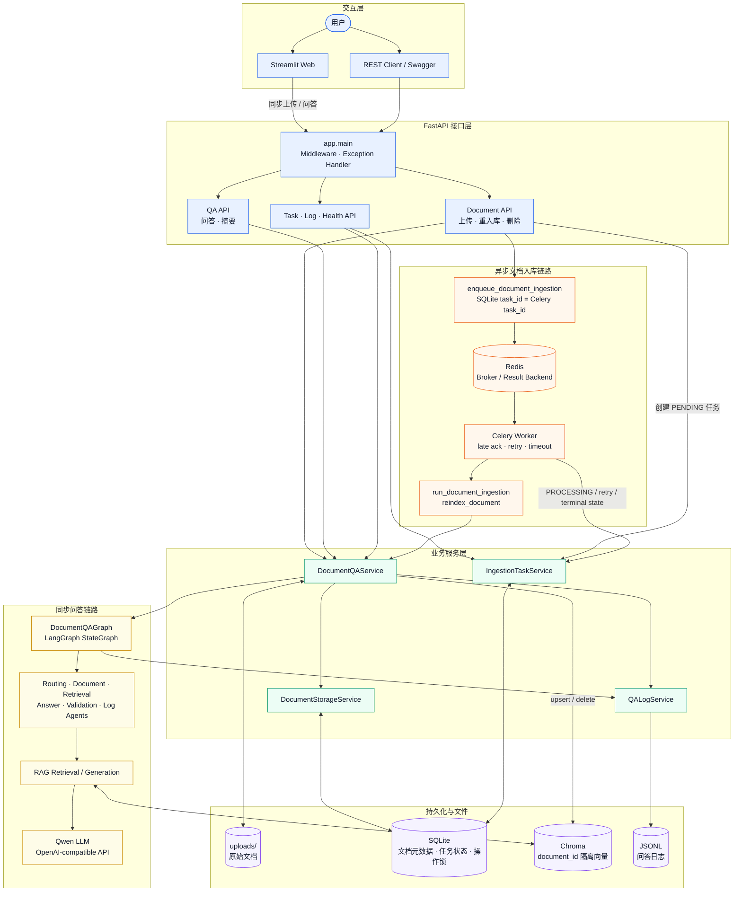
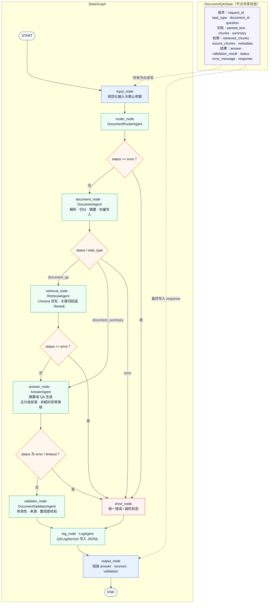

# Enterprise Document QA Platform

基于 **FastAPI、LangGraph、Chroma、Celery 与 Redis** 构建的企业文档智能问答平台，覆盖文档入库、RAG 检索、Agent 工作流、来源追踪、任务持久化与容器化部署。

## 项目介绍

项目面向企业内部知识库问答场景，将同步问答链路与耗时的文档向量化链路解耦：FastAPI 负责文档管理和问答接口，LangGraph 编排可观测的 Agent 节点，Celery Worker 在后台完成解析、切分、Embedding 和 Chroma 入库。

系统以 `document_id` 作为检索边界，回答同时返回来源片段；当检索证据不足或校验不通过时执行拒答，降低跨文档污染和无依据生成风险。SQLite 持久化文档元数据与异步任务状态，使任务结果在 API 或 Worker 重启后仍可查询。

## 核心技术栈

| 层级 | 技术 | 用途 |
| --- | --- | --- |
| API | FastAPI、Pydantic v2、Uvicorn | REST API、参数校验与异常响应 |
| Agent | LangGraph | 状态管理、节点编排与条件路由 |
| RAG | sentence-transformers、Chroma | Embedding、向量检索与持久化 |
| LLM | OpenAI-compatible client | 调用兼容接口完成回答和摘要 |
| Async | Celery、Redis | 后台入库、消息代理与有限重试 |
| Storage | SQLite、本地文件系统 | 文档元数据、任务状态、操作锁与上传文件 |
| Delivery | Docker Compose、Streamlit | 多服务编排与交互演示 |
| Quality | pytest | API、Agent、Graph、RAG 与 Service 回归测试 |

## 核心功能与技术亮点

- **LangGraph Agent 工作流**：使用 `input`、`router`、`document`、`retrieval`、`answer`、`validator`、`log`、`output` 和 `error` 节点组织问答；条件边负责摘要分流、异常收敛和超时处理。
- **可解释 RAG**：解析 PDF、DOCX 和文本类文档，按固定窗口切分；检索链路结合 Chroma 向量召回、重排、相关性过滤和关键词 fallback，并在响应中返回 `source_chunks`。
- **文档级隔离**：Chroma 查询通过 `document_id` metadata filter 限定检索范围；向量 ID 由文档 ID 与 chunk ID 稳定生成，重复执行采用 `upsert`，避免无界重复写入。
- **有依据回答与拒答**：Answer Agent 基于召回上下文生成结果，Validator Agent 检查来源、相关性和回答质量；无有效证据时返回明确的 no-answer 结果。
- **异步文档入库**：异步上传先保存文件和元数据，再以 SQLite `task_id` 发布 Celery 任务；独立 Worker 复用 `DocumentQAService.reindex_document()` 完成解析、切分、Embedding 与 Chroma 写入。
- **任务状态持久化**：`IngestionTaskService` 管理 `PENDING → PROCESSING → SUCCESS/FAILURE`，记录重试次数、chunk 数量、索引状态和错误原因，并通过唯一约束阻止同一文档产生并发活动任务。
- **一致性保护**：同步 reindex、delete 与活动异步任务进行冲突检查；SQLite 操作锁覆盖跨进程文档操作，Chroma 写入完成后校验实际向量数量。
- **工程化交付**：Docker Compose 编排 API、Redis、Celery Worker 和 Streamlit，并让 API 与 Worker 共享 SQLite、uploads、Chroma、logs 及 Embedding 模型缓存路径。

## 系统架构图

### 系统架构

同步问答由 FastAPI 调用 `DocumentQAService` 与 `DocumentQAGraph` 完成；异步入库则以 SQLite 中的 `task_id` 为业务主键，经 Redis 投递给独立 Celery Worker，并复用同一套文档解析、切分和 Chroma 写入逻辑。



### RAG 数据处理流程

入库链路保留稳定的 Chunk ID，并对 Chroma 写操作使用跨进程 SQLite 锁；检索链路优先使用带 `document_id` 过滤的向量检索，仅在 Chroma 无候选结果或查询失败时回退到关键词检索。

```mermaid
flowchart TB
    subgraph Ingestion["A. 文档入库"]
        Upload["文件上传<br/>TXT · MD · DOCX · text PDF"]
        Validate{"格式、大小、路径<br/>是否有效？"}
        Save["保存 uploads 文件<br/>写入 SQLite 文档元数据"]
        Parse["load_document<br/>提取可读文本"]
        Split["split_text<br/>chunk_size=800 · overlap=100"]
        HasChunks{"生成有效 Chunks？"}
        Prepare["REINDEX 尝试删除旧向量<br/>UPLOAD 直接准备写入"]
        Embed["SentenceTransformer Embedding<br/>BAAI/bge-small-zh-v1.5"]
        Hash["HashEmbedding<br/>模型不可用时降级"]
        Ids["稳定向量 ID<br/>document_id + chunk_id"]
        Upsert["Chroma upsert<br/>SQLite 跨进程写锁"]
        Verify{"向量数量<br/>与 chunk_count 一致？"}
        Stored["更新 SQLite<br/>vector_indexed=true · SUCCESS"]
        Failed["记录错误<br/>文档状态 / 任务 FAILURE"]

        Upload --> Validate
        Validate -->|是| Save
        Validate -->|否| Failed
        Save --> Parse
        Parse -->|成功| Split
        Parse -->|失败| Failed
        Split --> HasChunks
        HasChunks -->|是| Prepare
        HasChunks -->|否| Failed
        Prepare --> Embed
        Embed -. 加载或推理失败 .-> Hash
        Embed --> Ids
        Hash --> Ids
        Ids --> Upsert
        Upsert --> Verify
        Verify -->|一致| Stored
        Verify -->|不一致| Failed
    end

    subgraph Retrieval["B. 检索问答"]
        Question["问题 + document_id"]
        VectorSearch["Chroma query<br/>where document_id · candidate_k=10"]
        HasVector{"返回向量候选？"}
        Rerank["RuleBasedReranker<br/>关键词 · 语义分数 · 标题命中"]
        Filter["相关性过滤<br/>主题约束 · 关键词重合 · rerank_score>=1.2"]
        Relevant{"存在相关片段？"}
        Keyword["关键词回退检索<br/>仅限无候选或 Chroma 异常"]
        FallbackFilter["主题 / 重合度 / 分数过滤"]
        HasFallback{"存在回退片段？"}
        Sources["来源片段<br/>retrieval_source + chunk_id"]
        Context["构建上下文<br/>最多 3 Chunks · 每段 800 字符"]
        Generate["Qwen 生成答案<br/>非超时异常时抽取式降级"]
        Reject["无依据拒答<br/>retrieval_source=none"]
        ValidateAnswer["答案校验<br/>来源 · 置信度 · 范围 · 重复度"]
        Response["结构化响应<br/>answer + source_chunks"]

        Question --> VectorSearch
        VectorSearch --> HasVector
        HasVector -->|是| Rerank
        Rerank --> Filter
        Filter --> Relevant
        Relevant -->|是| Sources
        Relevant -->|否，不再回退| Reject
        HasVector -->|否 / 查询异常| Keyword
        Keyword --> FallbackFilter
        FallbackFilter --> HasFallback
        HasFallback -->|是| Sources
        HasFallback -->|否| Reject
        Sources --> Context
        Context --> Generate
        Generate --> ValidateAnswer
        Reject --> ValidateAnswer
        ValidateAnswer --> Response
    end

    Stored -. 入库完成后可检索 .-> Question

    classDef input fill:#e8f1ff,stroke:#2563eb,color:#0f172a;
    classDef process fill:#ecfdf5,stroke:#059669,color:#0f172a;
    classDef decision fill:#fff7ed,stroke:#ea580c,color:#0f172a;
    classDef store fill:#f5f3ff,stroke:#7c3aed,color:#0f172a;
    classDef error fill:#fef2f2,stroke:#dc2626,color:#0f172a;
    class Upload,Question input;
    class Save,Parse,Split,Prepare,Embed,Hash,Ids,Rerank,Filter,Keyword,FallbackFilter,Sources,Context,Generate,ValidateAnswer process;
    class Validate,HasChunks,Verify,HasVector,Relevant,HasFallback decision;
    class Upsert,Stored,Response store;
    class Failed,Reject error;
```



### LangGraph 问答工作流

下图严格对应 `DocumentQAGraph._build_graph()` 注册的 9 个节点及条件边。检索为空不会新增一条图级条件边，而是由 `answer_node` 生成拒答文本，再交给 `validator_node` 校验并统一记录日志。



## 项目运行截图

当前仓库暂未提交运行截图。为避免使用模拟图片或与真实版本不一致的占位图，本节不展示虚假界面；启动项目后可直接通过 Streamlit 查看文档上传、任务状态、问答结果和来源片段，通过 Swagger UI 查看全部 API。

## 快速启动

需要 Docker Desktop 或兼容的 Docker Engine。先从公开模板创建本地环境文件，并按需填写 `DASHSCOPE_API_KEY`；不要提交真实 `.env`。

Linux / macOS：

```bash
cp .env.example .env
docker compose up --build -d
docker compose ps
```

Windows PowerShell：

```powershell
Copy-Item .env.example .env
docker compose up --build -d
docker compose ps
```

访问地址：

- FastAPI Swagger UI：<http://localhost:8000/docs>
- Streamlit：<http://localhost:8501>
- FastAPI Health：<http://localhost:8000/health>

停止服务并保留数据卷：

```bash
docker compose down
```

## 测试结果

```text
186 passed · 0 failed
```

完整测试命令：

```bash
python -m pytest -q
```
