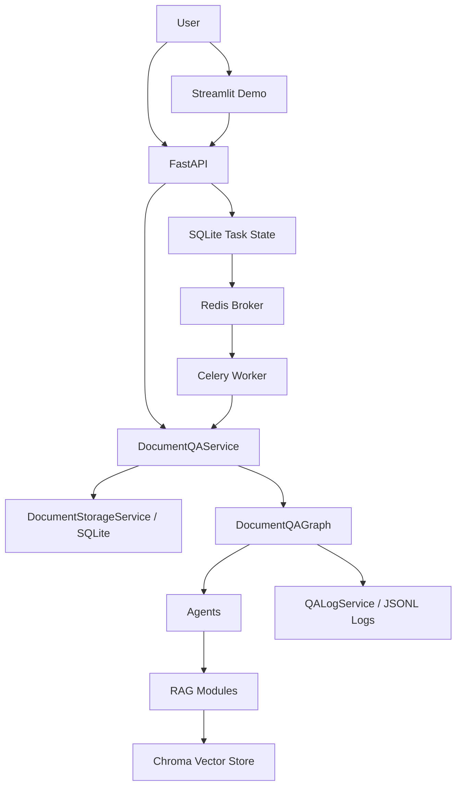
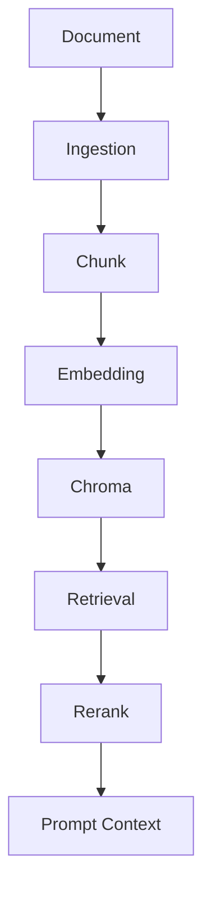
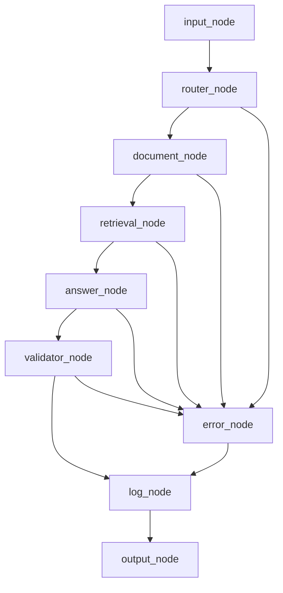

# Agent：企业文档智能问答平台

基于 **FastAPI + LangGraph + Chroma + Celery + Redis** 构建的企业文档智能问答系统，面向企业内部文档检索与知识问答场景，提供文档管理、语义检索、智能问答、来源追踪和异步文档入库等功能。

系统采用分层架构，通过 LangGraph 编排问答流程，利用 Chroma 实现向量检索与文档级过滤，结合 Celery 和 Redis 将文档解析、文本切分、Embedding生成及向量入库任务交由后台Worker执行，并通过SQLite持久化任务状态。

项目支持Docker Compose多服务部署，并提供自动化测试、任务状态查询、异常处理和问答日志等工程化能力。

## Features

- FastAPI：提供文档上传、问答、摘要、删除、日志和健康检查 API。
- LangGraph Workflow：用显式节点编排路由、文档处理、检索、回答、校验和日志。
- Chroma Vector Store：本地持久化向量库，保存和检索文档 chunks。
- Document Isolation：问答基于指定 `document_id`，避免跨文档污染。
- Source Attribution：返回 `source_chunks`，方便核对答案依据。
- No-answer Rejection：检索为空或校验不通过时返回拒答信息。
- QA Logging：记录检索来源、重排信息、耗时、模型和校验状态。
- Regression Tests：覆盖 API、RAG、Agent、LangGraph、服务层和评估集。
- Celery + Redis：异步上传和重新入库由独立 Worker 执行，SQLite 持久化任务状态。
- Streamlit Demo：提供轻量演示页面，便于本地展示完整链路。
- Legacy Compatibility：保留旧 task/tool/schema 入口，兼容早期调用方式。

## 系统架构



## RAG 数据处理流程



## LangGraph 问答流程



## 目录结构

```text
app/
├── agents/    LangGraph 节点外壳：routing、document、retrieval、answer、validation、log
├── api/       FastAPI 路由、接口拆分和异常处理
├── graphs/    LangGraph 状态定义和文档问答流程编排
├── rag/       ingestion、retrieval、generation、vector_store
├── schemas/   Pydantic 请求和响应模型，包含 legacy 兼容入口
├── services/  文档问答、存储、异步任务状态、LLM、日志和 legacy 服务
├── tasks/     Celery 文档入库任务
├── tools/     legacy document_tool 兼容包装
├── utils/     日志等通用工具
├── config.py  环境变量和路径配置
├── celery_app.py Celery 应用及可靠性配置
├── main.py    FastAPI 应用入口
└── prompts.py Prompt 常量

docs/          架构、流程、部署和测试说明
scripts/       自检、演示数据、Chroma 调试和索引重建脚本
tests/         API、RAG、Agent、LangGraph、服务层和评估集测试
web/           Streamlit 演示页面
```

## 技术栈

- Python 3.12
- FastAPI / Uvicorn
- LangGraph
- Chroma
- Pydantic v2
- SQLite
- Celery / Redis
- sentence-transformers
- OpenAI-compatible LLM client
- Streamlit
- pytest

## 快速启动

创建并激活 conda 环境：

```bash
conda create -n enterprise-doc-qa python=3.12 -y
conda activate enterprise-doc-qa
```

安装依赖：

```bash
pip install -r requirements.txt
```

如需完全复现实测环境，可使用锁定版本：

```bash
pip install -r requirements-lock.txt
```

配置环境变量：

```bash
copy .env.example .env
```

Linux / macOS：

```bash
cp .env.example .env
```

启动 FastAPI：

```bash
python -m uvicorn app.main:app --reload
```

访问：

```text
http://127.0.0.1:8000/docs
```

启动 Streamlit 演示：

```bash
streamlit run web/streamlit_app.py
```

访问：

```text
http://localhost:8501
```

## 环境变量

`.env.example` 不包含真实密钥。常用配置如下：

```text
APP_NAME=enterprise-document-qa-agent
APP_ENV=development
HOST=127.0.0.1
PORT=8000
LOG_LEVEL=INFO

EMBEDDING_MODEL_NAME=BAAI/bge-small-zh-v1.5
EMBEDDING_DEVICE=auto
EMBEDDING_PRELOAD=true
EMBEDDING_LOCAL_FILES_ONLY=true

DASHSCOPE_API_KEY=
DASHSCOPE_BASE_URL=
QWEN_MODEL=

DOCUMENT_DB_PATH=data/documents.db
CHROMA_DIR=chroma_db
UPLOAD_DIR=uploads
LOG_DIR=logs
API_BASE_URL=http://127.0.0.1:8000
CELERY_BROKER_URL=redis://127.0.0.1:6379/0
CELERY_RESULT_BACKEND=redis://127.0.0.1:6379/1
```

如果未配置真实 LLM Key，项目仍可运行本地解析、检索、日志和测试链路，并按当前服务逻辑使用 fallback 或显式错误处理。真实 Docker 验收中的远程 Qwen 请求曾返回权限类 `403`，因此不要把当前项目描述为已验证远程模型生成；本地 Chroma 检索、来源追踪和抽取式 fallback 已完成验证。

## API 说明

| 方法 | 路径 | 说明 |
| --- | --- | --- |
| `GET` | `/health` | 健康检查 |
| `POST` | `/api/documents/upload` | 上传文档 |
| `POST` | `/api/documents/upload/async` | 保存文档并提交后台入库任务，返回 `202` |
| `GET` | `/api/documents` | 获取文档列表 |
| `GET` | `/api/documents/tasks/{task_id}` | 查询 SQLite 中持久化的任务状态 |
| `POST` | `/api/documents/{document_id}/reindex` | 重新解析并入库已有文档 |
| `POST` | `/api/documents/{document_id}/reindex/async` | 提交后台重新入库任务，返回 `202` |
| `DELETE` | `/api/documents/{document_id}` | 删除单个文档 |
| `DELETE` | `/api/documents/batch` | 批量删除文档 |
| `POST` | `/api/documents/summary` | 生成文档摘要 |
| `POST` | `/api/qa/ask` | 基于指定文档问答 |
| `GET` | `/api/logs` | 查看问答日志 |
| `POST` | `/tasks/execute` | legacy task 执行入口 |

示例：

```bash
curl -X POST http://127.0.0.1:8000/api/documents/upload \
  -F "file=@tests/fixtures/sample_device_manual.txt"
```

```bash
curl -X POST http://127.0.0.1:8000/api/qa/ask \
  -H "Content-Type: application/json" \
  -d "{\"document_id\":\"YOUR_DOCUMENT_ID\",\"question\":\"设备启动前需要检查什么？\"}"
```

## Docker Compose 异步入库

复制环境变量文件后启动四个服务：

```bash
cp .env.example .env
docker compose config --quiet
docker compose up --build -d
docker compose ps
```

Windows PowerShell 使用 `Copy-Item .env.example .env`。Compose 启动 FastAPI、Redis、Celery Worker 和 Streamlit；Redis 不映射宿主机端口。`uploads/`、`data/`、`chroma_db/`、`logs/` 由 API 和 Worker 共享，Redis AOF 与 Embedding 缓存使用命名 volume 持久化。

首次启动默认允许容器下载 Embedding 模型并写入共享缓存。离线环境可在 `.env` 设置 `DOCKER_EMBEDDING_LOCAL_FILES_ONLY=true`，此时继续沿用项目既有的本地模型或 hash fallback 行为。

异步上传：

```bash
curl -X POST http://127.0.0.1:8000/api/documents/upload/async \
  -F "file=@tests/fixtures/sample_device_manual.txt"
```

接口成功时返回 `202 Accepted`，不会在请求中等待 Embedding 和 Chroma 入库：

```json
{
  "request_id": "...",
  "status": "PENDING",
  "message": "Document ingestion task submitted.",
  "elapsed_time": 0.01,
  "error_message": "",
  "task_id": "...",
  "document_id": "...",
  "operation": "UPLOAD",
  "retry_count": 0,
  "chunk_count": 0,
  "vector_indexed": false,
  "created_time": "...",
  "updated_time": "..."
}
```

查询 SQLite 持久化状态：

```bash
curl http://127.0.0.1:8000/api/documents/tasks/YOUR_TASK_ID
```

完成后的关键字段如下：

```json
{
  "task_id": "...",
  "document_id": "...",
  "operation": "UPLOAD",
  "status": "SUCCESS",
  "retry_count": 0,
  "chunk_count": 4,
  "vector_indexed": true,
  "error_message": ""
}
```

异步重新入库：

```bash
curl -X POST http://127.0.0.1:8000/api/documents/YOUR_DOCUMENT_ID/reindex/async
```

查看 Worker 与 API 日志：

```bash
docker compose logs -f worker
docker compose logs -f api
```

常见排查顺序：先用 `docker compose ps` 确认 Redis 健康，再检查 Worker 是否注册 `app.tasks.document_ingestion.ingest_document`，最后核对 API 与 Worker 中的 `DOCUMENT_DB_PATH`、`CHROMA_DIR` 和挂载目录是否一致。API 不以 Redis 健康作为启动前提，因此 Redis 故障不会阻断旧同步接口；异步投递失败也不会返回虚假成功，SQLite 任务会进入明确的 `FAILURE`，Redis 恢复后可通过异步 reindex 创建新任务恢复。

同步接口会在请求内完成解析和向量入库；异步接口只保存文件和元数据并发布任务。两者共用 `DocumentQAService` 入库实现和稳定向量 ID。活动异步任务期间，同一文档的同步 reindex/delete 返回 `409`；Chroma 的初始化、upsert 和 delete 还通过共享目录内的 SQLite 事务锁跨进程序列化。

宿主机数据目录可在 `.env` 中用 `UPLOADS_HOST_PATH`、`DATA_HOST_PATH`、`CHROMA_HOST_PATH`、`LOGS_HOST_PATH` 改到隔离位置，适合端到端验收时避免使用正式数据。

## 项目截图

当前仓库不提交运行时截图，下面是建议补充的位置：

```text
docs/assets/streamlit-overview.png
docs/assets/document-upload.png
docs/assets/qa-result-with-sources.png
docs/assets/api-docs.png
```

建议截图内容：

- Streamlit 系统概览页。
- 文档上传和索引状态。
- 问答结果和来源片段。
- FastAPI Swagger 文档页。

## 测试

运行全部测试：

```bash
python -m pytest -q
```

当前稳定基线：

```text
186 passed, 0 failed, 1352 warnings
```

warning 主要来自 Chroma 内部触发的 Pydantic deprecated API，以及 LangGraph / LangChain 的 pending deprecation；当前没有项目自身代码产生的 pytest warning。

真实 Docker Compose 环境已验证异步上传、Redis 消息分发、独立 Worker 执行、SQLite 任务状态、Chroma 入库、来源追踪、异步 reindex 和容器重启后的数据持久化。该结果不代表 exactly-once，也不保证 Worker 强制退出后任务状态立即恢复；SQLite 与 Chroma 之间不存在跨系统原子事务。

## 项目亮点

- 清晰分层：API、Service、Graph、Agent、RAG、Schema 分工明确。
- 行为可回归：核心路径有 pytest 覆盖，便于重构后验证业务不变。
- 可解释回答：问答结果返回来源片段，支持人工核对。
- 拒答机制：检索和校验不足时不强行生成答案。
- 文档隔离：基于 `document_id` 进行检索，减少上下文串扰。
- 后台入库：Celery + Redis 将解析、切分、Embedding 和向量写入移出 HTTP 请求。
- 状态持久化：任务状态保存在 SQLite，服务重启后仍可查询历史结果。
- 工程化交付：包含 `.env.example`、锁定依赖、Docker、docs、测试说明和 legacy 兼容说明。

## Legacy 接口说明

项目保留少量 legacy 入口，用于兼容早期 task/tool 调用方式：

- `POST /tasks/execute`：历史 task 执行接口。
- `app/services/legacy_task_service.py`：legacy task 服务实现。
- `app/services/task_service.py`：历史 `TaskService` 名称兼容入口。
- `app/tools/document_tool.py`：旧 document tool 包装层。
- `app/schemas/legacy.py`：旧 schema import 路径 re-export shim。

这些路径仍有兼容价值，本轮不删除。未来下线前应先确认外部调用方和测试都已迁移。

## 数据目录

以下目录是运行时数据，不应提交到 Git；公开模板 `.env.example` 例外，应随源码提交：

```text
.env
.env.*
uploads/
logs/
chroma_db/
chroma_db_backup_*/
data/*.db
model_cache/
.cache/
.venv/
venv/
__pycache__/
*.pyc
.pytest_cache/
pytest-cache-files-*/
.coverage
htmlcov/
```

## 更多文档

- [架构说明](docs/architecture.md)
- [工作流说明](docs/workflow.md)
- [部署说明](docs/deployment.md)
- [测试说明](docs/testing.md)
