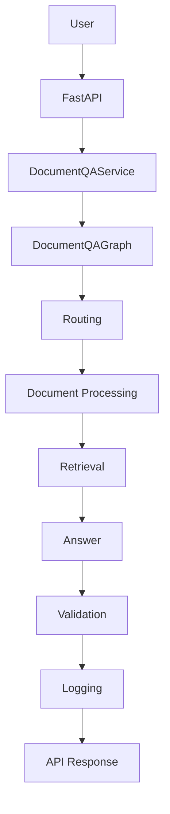
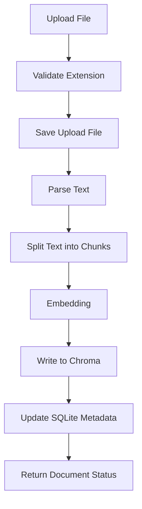
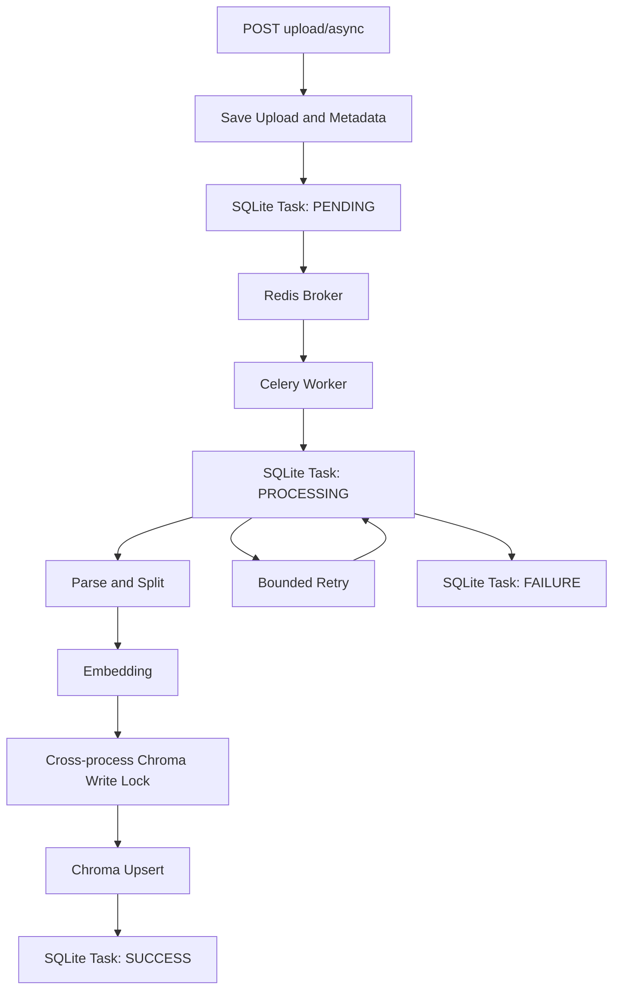
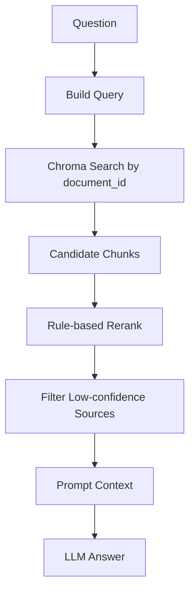
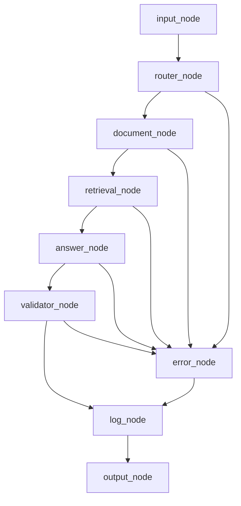

# Workflow

本文描述文档上传入库、RAG 检索和 LangGraph 问答的完整流程。

## 总览

## 同步文档入库流程

文档入库的关键点：

- 支持 `txt`、`md`、`docx` 和文本型 `pdf`。
- 上传文件保存在 `uploads/`。
- 文档元数据保存在 SQLite。
- chunk 向量写入 `chroma_db/`。
- 运行时数据不提交到 Git。

同步接口在 HTTP 请求中完成解析、切分、Embedding 和 Chroma 入库，适合本地调试和向后兼容。

## 异步文档入库流程

异步接口只在请求中校验并保存文件、创建文档元数据和发布任务，成功时返回 `202`、`task_id` 与 `document_id`。任务状态由 SQLite 持久化，可通过 `GET /api/documents/tasks/{task_id}` 查询。Redis 投递失败不会返回虚假成功：任务进入 `FAILURE`，上传场景可通过异步 reindex 创建新任务恢复。

同一文档只有一个 `PENDING` 或 `PROCESSING` 任务。活动任务期间，同步 reindex 和删除返回 `409`。不同文档可以并发提交，但 Chroma 的写入和删除会通过共享目录中的 SQLite 锁串行化。

Worker 使用 `acks_late`、Redis visibility timeout 和有限重试降低异常中断影响，但这些机制不提供 exactly-once 保证，也不保证 Worker 强制退出后任务状态立即恢复。

## RAG 检索流程

检索始终带有 `document_id`，避免不同文档之间互相污染。返回结果中包含 `source_chunks`，用于展示答案依据。

## LangGraph 问答流程

节点职责：

- `input_node`：初始化请求状态。
- `router_node`：判断任务路由。
- `document_node`：解析文档并准备 chunk 信息。
- `retrieval_node`：检索候选来源片段。
- `answer_node`：基于来源片段生成答案。
- `validator_node`：校验答案是否有依据。
- `log_node`：写入 QA 日志。
- `output_node`：生成最终响应。
- `error_node`：统一错误状态。

## 拒答流程

当检索不到可靠来源，或答案校验不通过时，系统会返回无答案提示，而不是强行生成看似合理但缺少依据的回答。这是项目面向企业文档问答场景的重要约束。

## 日志流程

QA 日志写入 `logs/qa_logs.jsonl`，包含：

- 请求 ID、文档 ID、问题和答案。
- 检索来源、top score、rerank score。
- 各阶段耗时。
- LLM 和 embedding 模型信息。
- 校验状态和错误信息。
